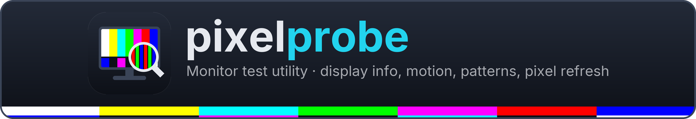
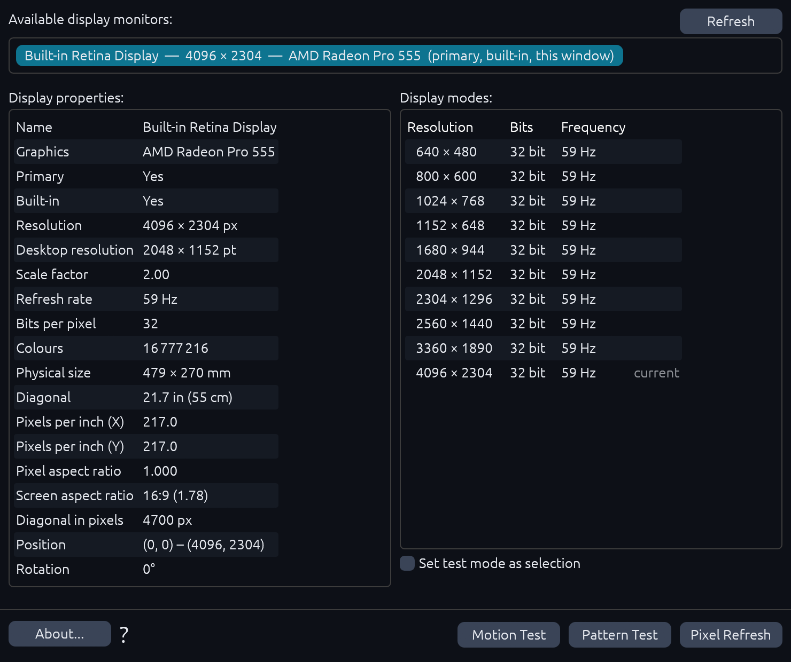
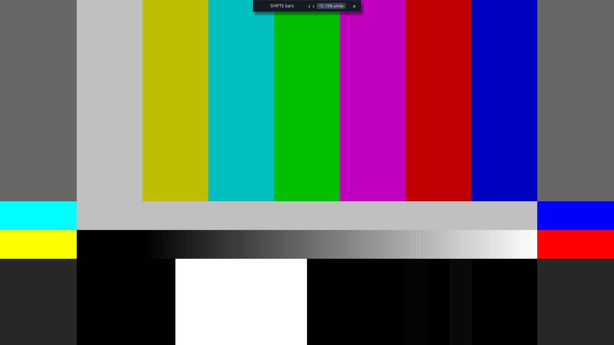
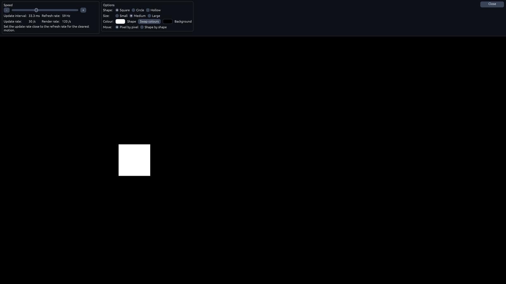
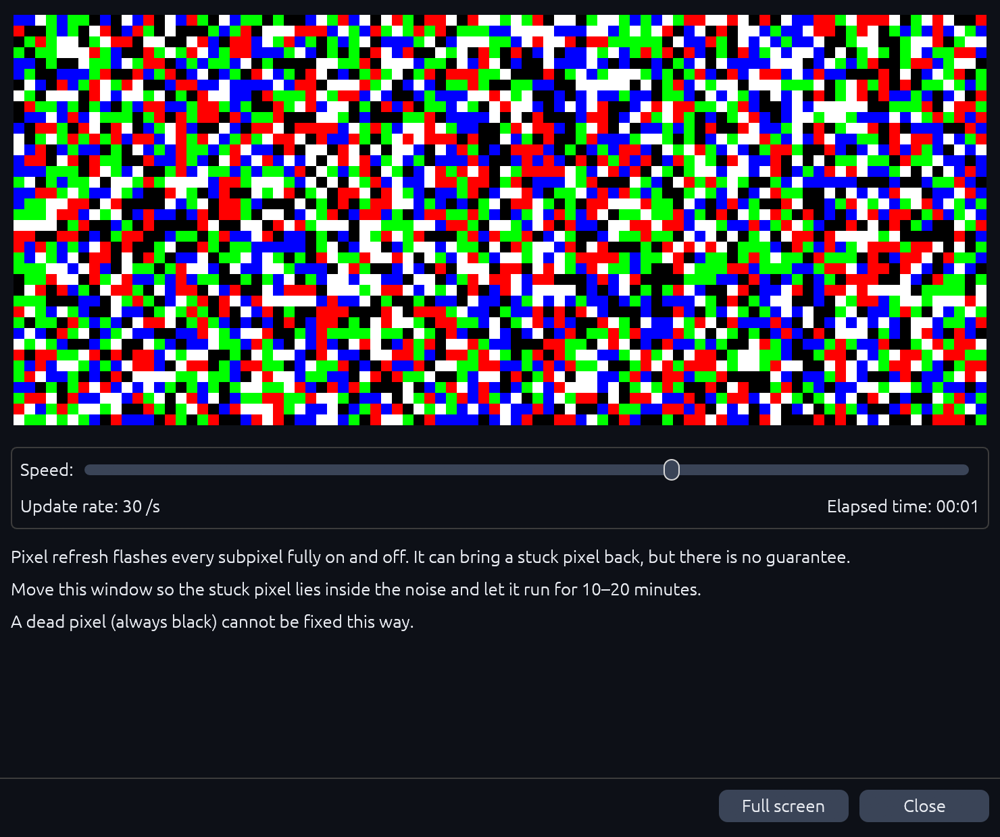

<div align="center">

<p align="center">
  
</p>



**A monitor test utility: see what your displays report, check them with full-screen test
patterns and a motion test, and run pixel refresh noise over stuck pixels.**

[](https://github.com/nazdravan/pixelprobe/actions/workflows/ci.yml)
[](#license)
[](rust-toolchain.toml)
[](https://github.com/emilk/egui)
[](#macos)
[](#windows-and-linux)
[](#windows-and-linux)
[](#web)

[**Website**](https://nazdravan.github.io/pixelprobe/) · [Run in the browser](https://nazdravan.github.io/pixelprobe/app/) · [Quick start](#quick-start) · [Features](#features) · [Keyboard shortcuts](#keyboard-shortcuts) · [Design decisions](#design-decisions) · [Code structure](#code-structure) · [Changes](CHANGELOG.md) · [Releases](../../releases) · [Issues](../../issues)

</div>

<br />

pixelprobe is written in **Rust** and inspired by the features of *Monitor Test Utility*. It is
not affiliated with that program and uses none of its code or assets: test-pattern colours and
geometry come from published standards (SMPTE RP 219), monitor data from the operating system
and the monitors' own EDID.



## Quick start

Packages for Windows, macOS and Linux are published on the [Releases](../../releases) page by
the release workflow; there is no published release yet, so for now build from source. Each
release will have:

```
pixelprobe-<version>-linux-x86_64.AppImage        # Linux, one file
pixelprobe-<version>-linux-x86_64.deb             # Ubuntu / Debian / Mint
pixelprobe-<version>-linux-x86_64.tar.gz          # Linux, archive
pixelprobe-<version>-macos-universal.dmg          # macOS (Apple Silicon and Intel)
pixelprobe-<version>-windows-x64.msi              # Windows 10/11, installer
pixelprobe-<version>-windows-x64-portable.zip     # Windows 10/11, no installation
SHA256SUMS.txt                                    # checksums
```

- **Windows:** the `.msi` installs pixelprobe into *Program Files* with a Start menu entry;
  the `.zip` needs no installation. The files are not signed, so SmartScreen asks on first
  start: *More info → Run anyway*.
- **Linux:** make the AppImage executable and start it
  (`chmod +x pixelprobe-*.AppImage && ./pixelprobe-*.AppImage`), or install the `.deb`
  (`sudo apt install ./pixelprobe-*.deb`).
- **macOS:** open the `.dmg` and drag `pixelprobe.app` onto *Applications*. It is not signed
  with an Apple certificate, so the first start is blocked; see [macOS](#macos).

### From source

Install [Rust](https://rustup.rs), then in this folder:

```sh
cargo run --release          # starts the app
```

The right Rust version (`rust-toolchain.toml`) is installed automatically. The program is
`target/release/pixelprobe` (`pixelprobe.exe` on Windows); it is a single file and needs nothing
else next to it. On Linux, building needs the X11/Wayland development packages that eframe uses
(see `.github/workflows/ci.yml` for the list on Ubuntu).

---

## Features

| | |
|---|---|
| **Display information** | every monitor with its name, graphics adapter, resolution, scale, refresh rate, colour depth, physical size, diagonal, pixels per inch, aspect ratios, position and rotation, plus the display modes it supports |
| **Pattern test** | 15 full-screen patterns at the display's own resolution: SMPTE colour bars, solid colours, gray 50 %, gray ramp and steps, RGB ramps, black and white level patches, a grid and two checkerboards |
| **Motion test** | a square or circle moving across the screen at 5 to 240 steps per second, for blur, ghosting and uneven motion |
| **Pixel refresh** | random red, green, blue, white and black cells, in a window or full screen, to exercise stuck pixels |
| **Test mode** | run the tests full screen on any monitor, optionally switched to a chosen display mode and restored afterwards |
| **Interface** | dark and light theme following the system, keyboard shortcuts, undo for every setting, help screen (F1) |

### Pattern test



- the patterns fill the selected monitor at its own resolution, one image pixel per screen pixel;
- **SMPTE bars** follow SMPTE RP 219:2002, with the standard's sub-pattern options: 75 % or
  100 % white, +I, and −I with +Q (**V** or the toolbar button cycles them);
- the toolbar at the top (pattern name, previous / next, close) and the mouse cursor hide after
  3 seconds without movement; ← and → change the pattern, Esc closes.

### Motion test



- shape: square or circle, filled or hollow; size small, medium or large; shape and background
  colours with a swap (**S**);
- movement pixel by pixel (1/16 of the shape) or shape by shape; speed from 5 to 240 steps per
  second (↑ / ↓);
- the bar shows the update interval and rate, the display's refresh rate and the rate the app
  actually draws at. Setting the update rate close to the refresh rate gives the clearest picture.

### Pixel refresh



- red, green, blue, white and black cells change many times a second (1 to 60 updates per
  second, ↑ / ↓), with the elapsed time;
- in the window, move the stuck pixel under the noise; **F** or *Full screen* covers the whole
  display. It can bring a stuck pixel back; a dead (always black) pixel cannot be fixed.

### Keyboard shortcuts

Cmd is the Command key on macOS and Ctrl elsewhere. Keys work on the screen they belong to.

<!-- shortcuts:start -->
| Key | Action |
|---|---|
| `Cmd+Shift+Z` | Edit › Redo |
| `Cmd+Z` | Edit › Undo |
| `Down` | Motion › Slower |
| `Down` | Pixel Refresh › Slower |
| `Escape` | View › Close |
| `F` | Pixel Refresh › Full Screen |
| `F1` | Help › Help |
| `F5` | Display › Refresh |
| `Left` | Pattern › Previous |
| `M` | Tests › Motion Test |
| `P` | Tests › Pattern Test |
| `R` | Tests › Pixel Refresh |
| `Right` | Pattern › Next |
| `S` | Motion › Swap Colours |
| `Up` | Motion › Faster |
| `Up` | Pixel Refresh › Faster |
| `V` | Pattern › Next SMPTE Sub-pattern |
<!-- shortcuts:end -->

This table is checked against the app's command list by a test.

---

## Design decisions

Where pixelprobe differs from what a reader of the original program might expect:

- **Colour planes** are not shown: current graphics APIs no longer report them.
- **Interlaced modes** are not marked in the display modes list: the windowing library does not
  report it, and current displays are progressive.
- **Pixel refresh, help and about** are screens of the main window, not separate dialogs; pixel
  refresh also has a full-screen mode.
- **The pattern list, the speed ranges and the motion step** (1/16 of the shape) are pixelprobe's
  own choices.
- **Settings are undoable**: every change goes through a command, so Cmd+Z / Cmd+Shift+Z work
  on test settings too.

---

## macOS

The `.dmg` holds one `pixelprobe.app` for Apple Silicon and Intel Macs, macOS 10.13 and newer.
It has only an ad-hoc signature, so Gatekeeper blocks the first start: right-click → *Open*
(on macOS 15 and newer: *System Settings → Privacy & Security → Open Anyway*), or once in
Terminal:

```sh
xattr -dr com.apple.quarantine /Applications/pixelprobe.app
```

Monitor names, physical size, graphics adapter and refresh rate come from the system
(AppKit, CoreGraphics, Metal). Checked on an iMac 21.5″ 4K: 479 × 270 mm, 217 ppi, 59 Hz,
AMD Radeon Pro 555, all ten display modes, exclusive full screen in a chosen mode.

## Windows and Linux

Physical size, monitor names and the graphics adapter are read from the monitors' EDID: from the
registry on Windows, from `/sys/class/drm` on Linux. Both platforms build and pass the test
suite on GitHub Actions. **Note:** the app has not yet been started on a real Windows or Linux
machine.

## Web

`cargo xtask web` builds a browser version into `target/web` (it needs the `wasm-bindgen` CLI at
the version in `Cargo.lock`):

```sh
cargo xtask web
python3 -m http.server -d target/web   # then open http://localhost:8000
```

In the browser, display information is limited to what `window.screen` reports (no refresh
rate, physical size or modes), and full screen uses the browser's Fullscreen API.

---

## Code structure

| Path | Contents |
|---|---|
| `crates/pp-core` | data model: patterns, test settings, display information |
| `crates/pp-patterns` | test images: SMPTE bars, ramps, checkerboards, motion steps, refresh noise |
| `crates/pp-edid` | EDID parser (VESA E-EDID 1.4) and matching EDIDs to monitors |
| `crates/pp-engine` | the session, the command list with shortcuts, undo history |
| `crates/pp-control` | local control channel (`--control PORT`, JSON lines on 127.0.0.1) for scripting and screenshots |
| `crates/pp-ui` | the egui screens and the theme |
| `app/` | the desktop and web program: monitor enumeration, full screen, EDID sources |
| `packaging/` | release packages: AppImage, `.deb` and `.tar.gz` for Linux, `.app` and `.dmg` for macOS, `.msi` and `.zip` for Windows; `version.sh`, `changelog.sh` |
| `site/` | the landing page for GitHub Pages: `build.py` (theme colours, changelog and download links from the latest release), template, styles, tests |
| `xtask/` | `cargo xtask ci` (format, lint, tests, layer rules, wasm check) and `cargo xtask web` |
| `assets/` | `theme.toml` (all colours), `icon.py` (logo and icons), `banner.py` (this README's banner), `screenshots.py` (these screenshots, taken by the app), fonts |

## Release

The version lives in one place, `Cargo.toml`, and is changed with
`packaging/version.sh set 0.2.0`. Releases are **automatic**: a push to `main` with a version
that is not yet published builds the packages for every platform on GitHub Actions and
publishes the release, with the notes from [`CHANGELOG.md`](CHANGELOG.md). A push with the
same version only runs the tests. Details in [`docs/releasing.md`](docs/releasing.md).

## Tests

```sh
cargo xtask ci
```

`cargo xtask ci` runs formatting and lint checks, the tests (pattern pixel values against SMPTE RP 219, EDID
parsing on a real monitor's EDID, property tests on untrusted input, and headless UI tests that
click the real buttons), the layer rules and the web build check. GitHub Actions runs the same
on macOS, Windows and Linux. The images in `docs/assets/` are regenerated with:

```sh
python3 assets/icon.py && python3 assets/banner.py --og docs/assets/og.png
cargo build --release && python3 assets/screenshots.py
```

The landing page has its own tests (`python3 -m unittest discover -s site/tests`,
`node --test site/tests/main.test.mjs`) and builds with `python3 site/build.py --out _site`.

## License

Licensed under either of

- Apache License, Version 2.0 ([LICENSE-APACHE](LICENSE-APACHE) or <https://www.apache.org/licenses/LICENSE-2.0>)
- MIT license ([LICENSE-MIT](LICENSE-MIT) or <https://opensource.org/licenses/MIT>)

at your option.

Unless you explicitly state otherwise, any contribution intentionally submitted for inclusion
in the work by you, as defined in the Apache-2.0 license, shall be dual licensed as above,
without any additional terms or conditions.

The Inter font in `assets/fonts/` (used for the banner) is under the SIL Open Font License 1.1,
see `assets/fonts/Inter-LICENSE.txt`.
